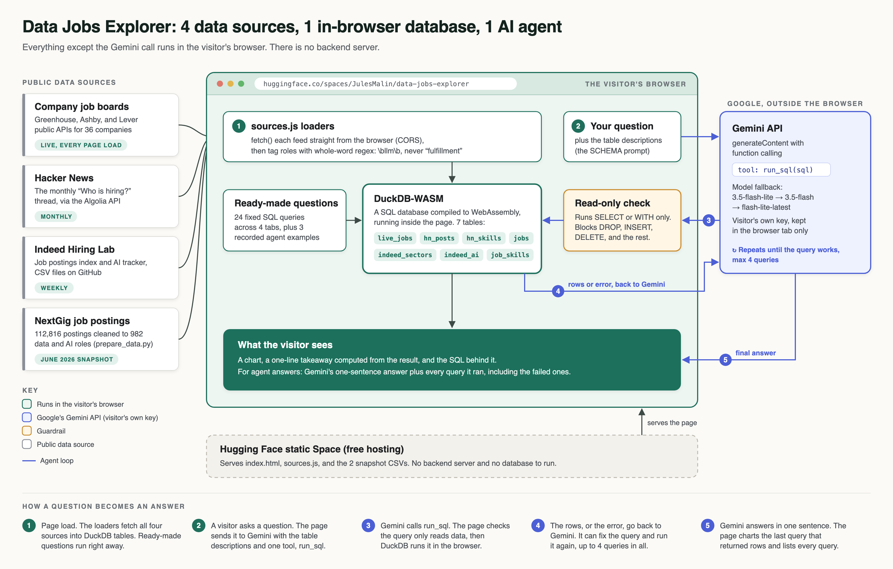
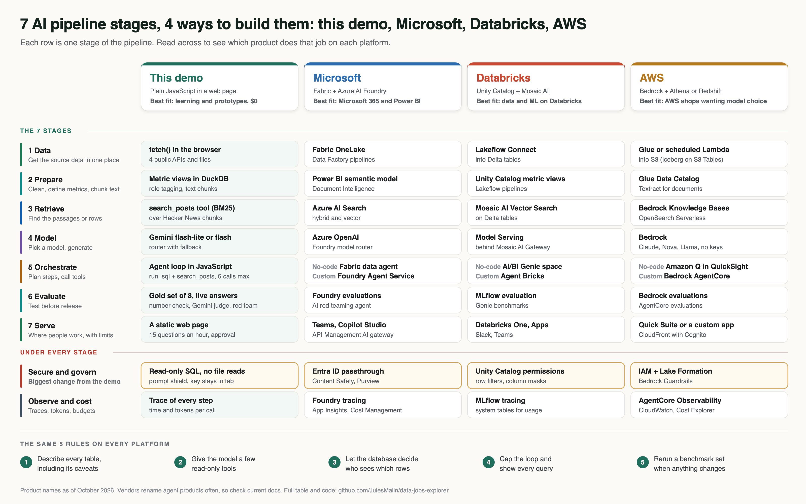

# Data Jobs Explorer: build an AI data tool in one page

**Live demo:** https://huggingface.co/spaces/JulesMalin/data-jobs-explorer

A working app that answers questions about data and AI hiring from four public sources, plus a step-by-step guide to building one like it for yourself or your company. Everything runs in the browser. There's no server, no database to host, and nothing to pay for.

Ask "Which companies have the most open AI engineer roles right now?" and three things happen:

1. Gemini reads a description of the tables and writes a SQL query.
2. The page checks the query is read-only, then runs it in DuckDB inside your browser.
3. You get a chart, the table, and the SQL itself, so you can check the work.

## How it works



The diagram source is [`docs/pipeline.svg`](docs/pipeline.svg), if you want to edit it for your own project.

## What's inside

| Tab | Source | How fresh |
|---|---|---|
| Live openings | Public job-board feeds from Greenhouse, Ashby, and Lever for 36 companies | Pulled live every time the page opens |
| Trends since 2020 | [Indeed Hiring Lab](https://github.com/hiring-lab) postings index and AI tracker (CC-BY-4.0) | Weekly |
| This month on HN | The latest "Ask HN: Who is hiring?" thread, via the HN Algolia API | Monthly |
| Skills | [NextGig job postings](https://huggingface.co/datasets/NextGig-Rocks/global-job-postings-multi-ats) (CC-BY-4.0), filtered to 982 data and AI roles | June 2026 snapshot |

The whole app is three files: [`web/index.html`](web/index.html) (the page and the AI), [`web/sources.js`](web/sources.js) (the data loaders), and [`prepare_data.py`](prepare_data.py) (cleans the snapshot).

## Run it

```bash
git clone https://github.com/JulesMalin/data-jobs-explorer
cd data-jobs-explorer/web
python3 -m http.server 8000
# open http://localhost:8000
```

Ready-made questions, the job search, and three recorded AI examples work right away. For your own questions, paste a free Gemini key from [aistudio.google.com/apikey](https://aistudio.google.com/apikey) into the page.

## The lessons

Each lesson is one thing you need to get right, where it lives in the code, and a real mistake this project made along the way.

### 1. Start from a question and a source you're allowed to use

Pick the question first ("what do data jobs ask for?"), then find data you can legally share. Check the license before you write any code. CC-BY means you can share it if you give credit. A scraped site usually means you can't.

**What happened here:** I had 177 job descriptions from my own pipeline, but they came from LinkedIn, so I didn't publish them. The NextGig and Indeed datasets are CC-BY-4.0, and the job boards are public feeds companies publish for their own careers pages.

**Try this:** find one public dataset for a question your team asks every week. Read its license.

### 2. Clean the data, then check it

[`prepare_data.py`](prepare_data.py) filters 112,816 postings down to data and AI roles with a regular expression on the job title, then writes two small tables.

**What happened here:** the first version matched "llm" anywhere in a title. "Fulfillment" contains "llm", so 327 warehouse and retail jobs showed up as AI engineers, and "order picking" ranked as a top skill. The fix was matching whole words (`\bllm\b`). The second surprise: the years-of-experience column was empty for 99.8% of postings, so that question was dropped.

**Try this:** after any filter, look at the top 10 values of every column. That's how both bugs got caught.

### 3. Pull live data straight from the browser

[`web/sources.js`](web/sources.js) fetches job boards, Hacker News, and Indeed's GitHub files directly. That only works when a server sends a CORS header that allows it. Greenhouse, Ashby, Lever, HN's Algolia API, and GitHub's raw files all do.

**What happened here:** one Indeed sector is named "IT Infrastructure, Operations & Support". The comma inside the quotes broke the CSV reader until the quote character was set explicitly.

**Try this:** pick one company's careers page and find its board name. Add it to `BOARDS` in `sources.js`.

### 4. Put the database in the browser

DuckDB compiled to WebAssembly runs real SQL on your laptop's CPU, inside the page. See `startDB()` and `ensure()` in [`web/index.html`](web/index.html). Each source becomes a table the first time a tab needs it, so the 12 MB Indeed file only downloads when someone opens Trends.

**Try this:** open the browser's developer console and time how long a query takes. It's usually a few milliseconds.

### 5. Let the AI write SQL, with guardrails

The prompt (`SCHEMA` and `RULES` in `index.html`) tells Gemini exactly which tables and columns exist, what the values look like, and which table to use for which kind of question. Then the page refuses to run anything that isn't a `SELECT` or `WITH` query.

Three guardrails do most of the work:
- **A precise schema.** The model only uses tables you describe, so describe them well, including the caveats ("salary is mostly empty").
- **Read-only.** A check blocks `insert`, `delete`, `drop`, and the rest before anything runs.
- **Bring your own key.** Each visitor's key stays in their browser tab and goes only to Google. Nobody can run up your bill.

### 5b. Turn the single call into a small agent

The first version made one call: Gemini wrote a query, and if the query failed, the visitor saw an error. Now Gemini gets one tool, `run_sql`, through the Gemini API's function calling. See `ask()` in [`web/index.html`](web/index.html). The loop:

1. Gemini reads the table descriptions and the question, then calls `run_sql` with a query.
2. The page checks the query is read-only, runs it in DuckDB, and sends back the first 30 rows or the error message.
3. Gemini reads that result. If the query failed, returned nothing, or looks wrong, it writes a new one.
4. After at most 4 queries, Gemini answers in one sentence, and the page charts the last query that returned rows.

The page lists every query the agent ran under the answer, so you can see each wrong turn and the fix. That's the whole idea of an agent: a model, a tool, a loop, and a limit on the loop.

**Try this:** ask a question with a typo in a column name, then open "What the agent did" and watch it recover.

### 6. Show the work, and check it

Every answer shows its SQL. That's the feature that matters most, because the model is confidently wrong in ways you can only see in the query.

**What happened here:**
- Asked "what share of data scientist roles are remote?", Gemini counted postings with no work model listed in the total, which pushed the percentage down.
- Asked "how do Data & Analytics postings compare with a year ago?", it compared against today's date. Indeed's data runs a few days behind, so the query returned nothing. One added sentence in the schema fixed it: use the latest date in the table, never today's.

**Try this:** ask five questions you already know the answer to. Read every query before you trust a number.

### 7. Ship it for free

The app is static files, so any static host works. This one runs on a free [Hugging Face static Space](https://huggingface.co/docs/hub/spaces-sdks-static). GitHub Pages works too.

**What happened here:** the first version of a related project used a Python server and local models. Hugging Face now charges for those, and it took hours to get right. Moving everything into the browser made hosting free and made the page load in seconds.

## Make it yours

The pattern works for any question your team keeps asking:

1. Swap the sources in `sources.js` for your own APIs or files.
2. Rewrite `SCHEMA` to describe your tables, including their caveats.
3. Replace the ready-made questions in `PRESETS` with the ten your team asks most.
4. Keep the read-only check and keep showing the SQL.

## Building this at a company: Microsoft, Databricks, and AWS

This demo is an agentic text-to-SQL app: one agent, one read-only SQL tool, a capped loop, and every query shown. Inside a company, each piece maps to a managed product.



What changes beyond the product names:

1. **The user's identity replaces the keyword check.** The agent queries as the person who asked, so the database only returns rows that person is allowed to see.
2. **A shared semantic layer replaces the prompt.** The definition of a metric lives in one certified model that both the agent and the dashboards use.
3. **A benchmark set replaces spot checks.** Keep 50 to 100 questions with known-correct SQL and rerun them whenever the model or the tables change.
4. **Every question gets logged, and use gets capped.** Each question, query, and answer is kept for audit, with spending limits per user or team.

Which to pick:

| If the company... | Start with |
|---|---|
| Runs Microsoft 365 and Power BI | A Fabric data agent |
| Does its data engineering and ML in Databricks | A Genie space on Unity Catalog |
| Runs on AWS and wants model choice or a custom agent | Bedrock AgentCore with Athena or Redshift |

Start with the no-code agent. Build a custom one when you need more than one tool, such as SQL plus document search plus a forecast model. Product names in this section change often, so check each vendor's docs.

## Credits and limits

Data: Indeed Hiring Lab and NextGig (both CC-BY-4.0), public job-board feeds from Greenhouse, Ashby, and Lever, and Hacker News posts (which belong to their authors; each result links back). Roles are matched from job titles, so some will be misfiled. Counts are directional, and the job boards cover 36 tech companies, not the whole market.

Code: MIT License. Built by Jules Malin.
